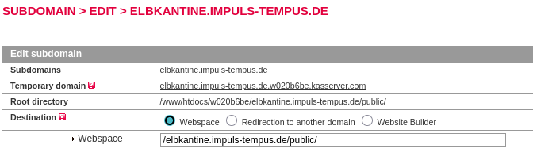
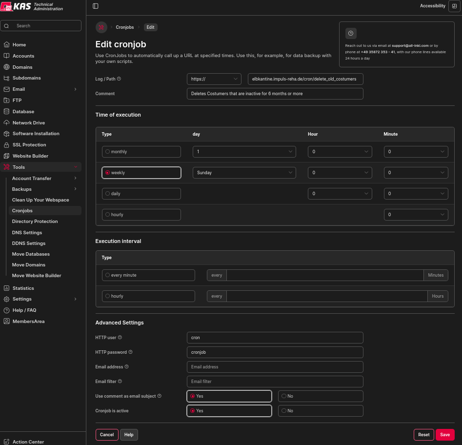
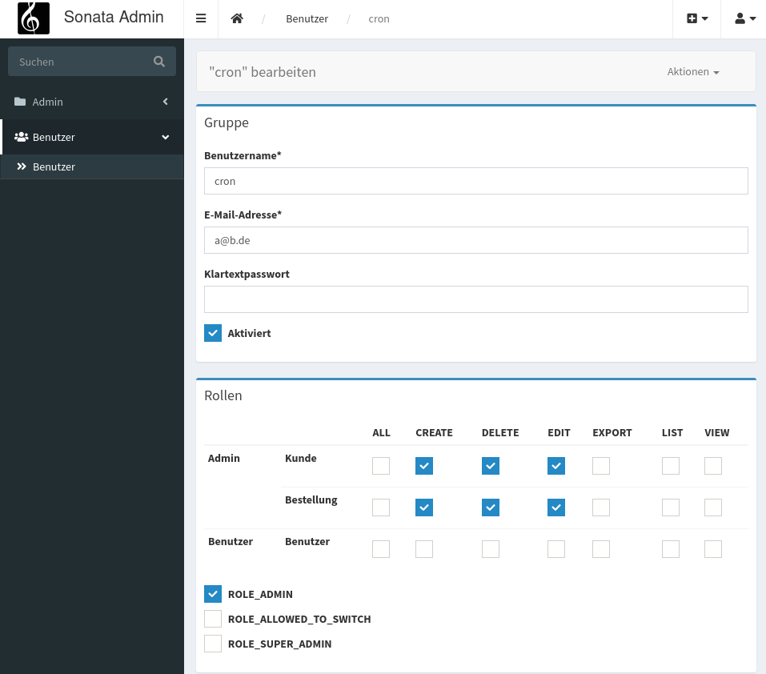

# Symfony Apps für die Kantine und die Zeiterfassung

Dieses Git-Repository enthält zwei Symfony Apps für die Kantinenabrechnung und Zeiterfassung der Impuls Reha & Arbeit Teilnehmer.
Die Auswahl, welche App aktiviert ist, erfolgt durch die Umgebungsvariable APP_ID.
Diese muss entweder auf 'kantine' oder 'zeiterfassung' gesetzt werden.
Auf dem Produktionsserver geschieht dieses in `public/.htaccess`, indem es schaut, über welche Subdomain die Seite aufgerufen wurde.

# Updating der Webseite

## Server Daten updaten

Nachdem der neue Code auf [github.com/it4impuls/KantineApp_symfony/](github.com/it4impuls/KantineApp_symfony/) geladen wurde, führe den [workflow deploy to all-Inkl (Production)](https://github.com/it4impuls/KantineApp_symfony/actions/workflows/Deploy_Prod.yml) aus (run workflow). Dies lädt alle wichtigen Daten auf den Server. Falls sich Daten zum Server geändert haben, müssen diese in [optionen -> Environments -> dev](https://github.com/it4impuls/KantineApp_symfony/settings/environments) von den Fachanleitern geändert werden.

## Neue composer packages installieren
Falls neue Packages installiert wurden, müssen diese auf dem Server installiert werden.
Logge dich dafür per ssh auf den Server ein und führe folgende Befehle aus:
```bash
cd kantine.impuls-reha.de       # Falls nicht schon im Ordner
export APP_ENV=prod
composer install --no-dev --optimize-autoloader
```

## Einrichten der MariaDB

Die MariaDB muss auf dem Database Host eingerichtet werden.
Man braucht eine Datenbank DATABASE_NAME, einen Benutzer DATABASE_USER@SYMFONY_HOST mit Passwort DATABASE_PASSWORD.
Die Datenbankeinstellungen `DATABASE_*` werden weiter unten als Symfony-Secrets für den Webserver gespeichert.
Sollten MariaDB und Symfony auf den gleichen Host laufen, benutze 'localhost' als SYMFONY_HOST.
Der Benutzer muss Vollzugriff auf die angelegte Daten haben.
Die Authentifizierung mittels Linux-Sockets wird von diesem Produkt nicht unterstützt.

Dazu führt man auf dem Datenbank Host aus:

```bash
sudo mariadb
```

In der sich öffnenden Kommandozeile müssen folgende SQL-Queries mit angepassten Daten ausgeführt werden:

```sql
CREATE DATABASE 'DATABASE_NAME';
CREATE USER IF NOT EXISTS 'DATABASE_USER'@'SYMFONY_HOST' IDENTIFIED BY 'DATABASE_PASSWORD';
GRANT ALL PRIVILEGES ON 'DATABASE_NAME'.* TO 'DATABASE_USER'@'SYMFONY_HOST';
```

Sollten Symfony und die MariaDB auf verschiedenen Hosts laufen, muss man die Listen-Adresse von MariaDB entsprechend erweitern und gegebenenfalls die Firewalleinstellungen anpassen.

## Update DB Zugangsdaten

Hier werden die Zugangsdaten von oben als Symfony-Secrets gespeichert:

```bash
cd kantine.impuls-reha.de       # Falls nicht schon im Ordner
export APP_RUNTIME_ENV=prod
php bin/console secrets:set DATABASE_HOST      # addresse zur Datenbank, normalerweise localhost
php bin/console secrets:set DATABASE_NAME      # Name der Datenbank
php bin/console secrets:set DATABASE_PASSWORD  # Passwort des Datenbank-Benutzers
php bin/console secrets:set DATABASE_USER      # Username des Datenbank-Benutzers

# nach Änderungen secrets exportieren (performence optimierung)
php bin/console secrets:decrypt-to-local --force
```

## DB Felder updaten
Falls Felder geändert wurden, (Änderungen in `/src/Entity/**`) **muss die Datenbank [migriert](https://symfony.com/doc/current/the-fast-track/en/8-doctrine.html#migrating-the-database) werden.** Mit
```bash
php bin/console make:migration
```
Migration erstellen **BEVOR** der Code auf Github gepusht wird.
Dies erstellt eine Datei im `migrations/` Ordner, welche auf den Server geladen werden muss. (siehe "Server Daten updaten")
Dann per ssh auf Server einloggen und 
```bash
cd kantine.impuls-reha.de       # Falls nicht schon im Ordner
php bin/console doctrine:migrations:migrate
```
ausführen.

# Server Installation
Schritte für Update zuerst ausführen, um dann den Code auf den Server hochzuladen und composer packages zu installieren.

## Per SSH auf Server einloggen
Vom eigenen PC mit
```
ssh {{ssh-user}}@{{ssh-host}}
```
auf dem Server einloggen. {{...}} mit echten Daten ersetzen.
In den Ordner wechseln
```bash
cd kantine.impuls-reha.de
```


## Secrets hochladen/setzen / generate JWT
Falls Secrets und decrypt key in `/config/secrets/prod/` von einer vorherigen Installation vorhanden sind, lade diese auf den Server hoch. Die Dateien haben das Format `prod.{{secret_name}}.{{random_hex}}.php`, sowie `prod.decrypt.private.php`, `prod.encrypt.public.php`, `prod.list.php`.

Falls eines dieser Dateien nicht vorhanden ist, müssen die Secrets [neu generiert werden](https://symfony.com/doc/current/configuration/secrets.html#generate-cryptographic-keys):
```bash
export APP_RUNTIME_ENV=prod 
php bin/console secrets:generate-keys
php bin/console secrets:set APP_SECRET --random
php bin/console secrets:set JWT_PASSPHRASE --random
php bin/console lexik:jwt:generate-keypair
```

DB Zugangsdaten setzen (siehe "Update DB Zugangsdaten").

## Datenbank migration

### Option 1: Bestehende Datenbank importieren
Falls eine Datenbank bereits besteht kann diese einfach importiert werden.

### Option 2: Leere Datenbank erstellen
Um das Datenbank Schema in die Datenbank zu übernehmen, muss
```bash
php bin/console doctrine:migrations:migrate
```
ausgeführt werden.

## Assets installieren

Sonata braucht mehrere Assets, d.h. standard CSS, JS etc. Dateien, um korrekt zu funktionieren.
Diese installiert man mit folgenden Befehlen:

```bash
php bin/console asset-map:compile
php bin/console assets:install
```

Beachte, dass der obige compile Schritt von der JWT_PASSPHRASE abhängt.

## All-ink auf den `public` Ordner verweisen
Webspace Directory muss in den public order zeigen!
* In all-inkl mit KAS account anmelden
* Subdomain -> Subdomain -> Edit
in Webspace `public/` hinter dem bestehenden Namen eingeben.



## Superuser erstellen

```bash
php bin/console sonata:user:create --super-admin "{{username}}" "{{email}}" "{{password}}"
```
{{ }} mit den tatsächlichen Daten ersetzen.

## Sonstige Accounts erstellen
Nun sollte die Webseite funktionieren. Auf der Admin-Seite [kantine.impuls-reha.de/admin](kantine.impuls-reha.de/admin) anmelden. Unter `Benutzer -> Benutzer` Neuen Benutzer anlegen.

Wichtig!!! Achte auf die Rollen. Gib neuen Account nur so viele Rechte wie er tatsächlich braucht. (z.B. kantine nur Zugriff auf Bestellungen, TN-Verwaltung nur Zugriff auf Kunden etc. )

Stelle sicher dass "Aktiviert" angekreuzt ist, damit man sich auch damit anmelden kann.


## Cronjobs
Das Löschen alter, inaktiver Teilnehmer läuft in einem cronjob. Dieser muss im all-inkl unter `Tools` -> `cronjobs` eingerichtet werden. https://all-inkl.com/wichtig/anleitungen/kas/tools/cronjobs/einrichtung_479.html:


Es muss ein Benutzer mit `Costumer delete` Privilegien angelegt werden und dessen Login-Informationen unter `advanced` abgelegt werden.



# Testing
## Requirements
Extra Datenbank dessen Zugangsdaten in .env.test eingetragen sind:
```env
# define your env variables for the test env here
KERNEL_CLASS='Shared\Kernel'
APP_SECRET='$ecretf0rt3st'

DATABASE_HOST='localhost'
DATABASE_NAME='test'
DATABASE_USER='localuser'
DATABASE_PASSWORD='localuser'
```

DB initialisieren:
```bash
php bin/console doctrine:database:create --env=test -ikantine
php bin/console doctrine:schema:update --env=test --force -ikantine
```

run tests:
```bash
php bin/console doctrine:fixtures:load --env=test -ikantine 
php bin/phpunit  --display-deprecations 
```
